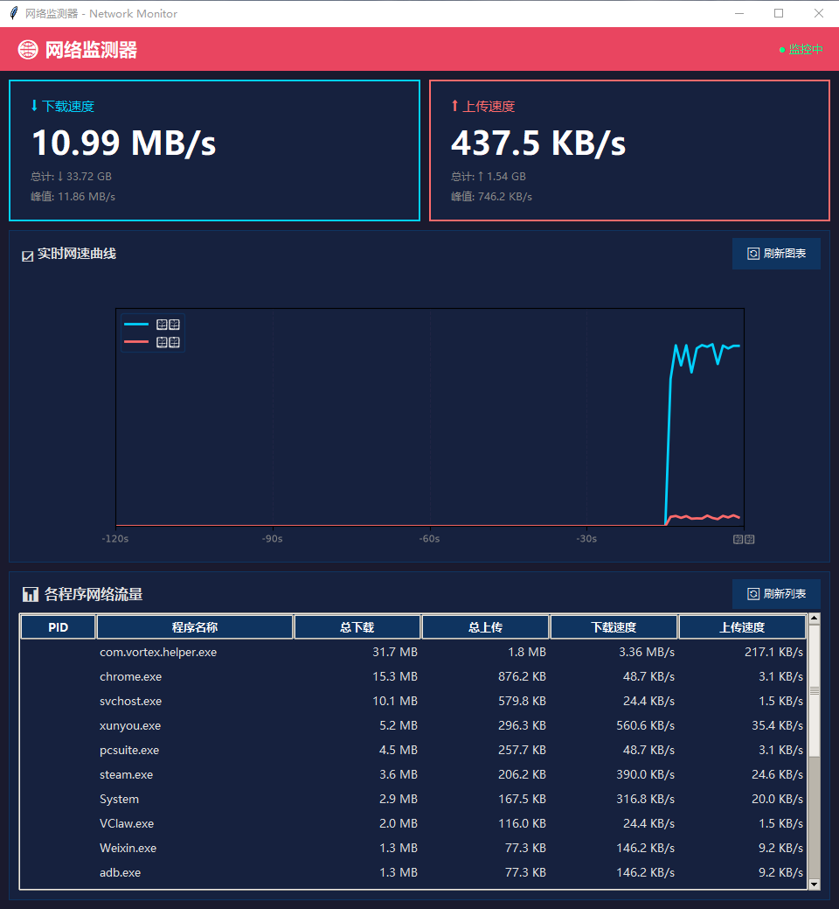
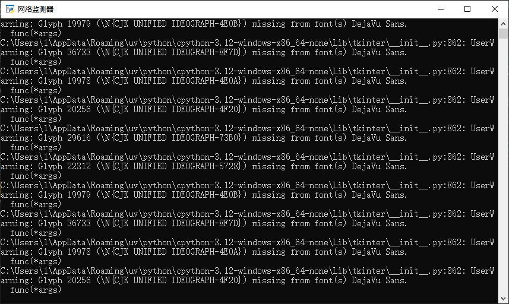

# 网络监测器 / Network Monitor

[](https://opensource.org/licenses/MIT)
[](https://www.python.org/downloads/)
[](https://www.microsoft.com/windows)

 一款功能强大的实时网络监控工具，提供直观的图形化界面，让您随时了解网络使用情况和各程序的网络流量。

A powerful real-time network monitoring tool with an intuitive graphical interface, allowing you to monitor network usage and program traffic at any time.



## ✨ 功能特性 / Features

- 📊 **实时网速监控** - 下载/上传速度、总流量、峰值统计
- 📈 **波浪形曲线图** - 最近120秒的网速变化趋势
- 🖥️ **程序流量统计** - 显示各程序的网络占用情况
- 🎨 **现代化界面** - 深色主题，美观护眼
- 🔄 **一键刷新** - 清空历史数据，重置统计
-  **独立运行** - 打包为 exe，无需 Python 环境
- 🚀 **轻量级** - 低资源占用，高效运行

##  截图 / Screenshots

### 主界面


### 运行效果



## 🚀 快速开始 / Quick Start

### 方法一：直接运行 exe（推荐普通用户）

1. 下载 [最新 release](https://github.com/yourusername/network-monitor/releases)
2. 双击运行 `NetMonitor.exe`
3. 开始监控网络！

### 方法二：从源码运行（推荐开发者）

#### 环境要求

- Python 3.8+
- Windows 10/11

#### 安装依赖

```bash
# 克隆仓库
git clone https://github.com/yourusername/network-monitor.git
cd network-monitor

# 安装依赖
pip install -r requirements.txt
```

#### 运行程序

```bash
python net_monitor.py
```

### 方法三：完整安装

1. 下载源码或 release 包
2. 运行 `install.bat`
3. 程序将安装到 `C:\Program Files\网络监测器`
4. 自动创建桌面和开始菜单快捷方式

## 📖 使用说明 / Usage

### 界面说明

- **顶部卡片**：实时显示下载/上传速度、总流量、峰值
- **中间图表**：120秒波浪形网速曲线（蓝色=下载，红色=上传）
- **底部列表**：各程序的网络流量统计（按流量排序）

### 功能按钮

- **🔄 刷新图表**：清空历史数据，重置峰值统计
- **🔄 刷新列表**：手动刷新程序流量列表

### 快捷键

- `Ctrl+R`：刷新图表
- `Ctrl+Q`：退出程序

## ️ 技术栈 / Tech Stack

- **Python 3.12** - 主要开发语言
- **Tkinter** - GUI 框架
- **Matplotlib** - 数据可视化
- **psutil** - 系统监控
- **PyInstaller** - 程序打包

## 📦 项目结构 / Project Structure

```
network-monitor/
├── net_monitor.py          # 主程序源代码
── requirements.txt        # Python 依赖
├── install.bat            # Windows 安装脚本
├── uninstall.bat          # Windows 卸载脚本
├── README.md              # 项目说明（本文件）
├── README_EN.md           # English documentation
├── LICENSE                # MIT 许可证
├── .gitignore            # Git 忽略文件
└── screenshot.png        # 项目截图
```

## 🤝 贡献 / Contributing

欢迎提交 Issue 和 Pull Request！

Contributions are welcome! Please feel free to submit issues and pull requests.

### 开发指南

1. Fork 本仓库
2. 创建特性分支 (`git checkout -b feature/AmazingFeature`)
3. 提交更改 (`git commit -m 'Add some AmazingFeature'`)
4. 推送到分支 (`git push origin feature/AmazingFeature`)
5. 开启 Pull Request

## 📝 更新日志 / Changelog

### v1.0.0 (2026-10-21)

- ✨ 初始版本发布
- 📊 实时网速监控功能
- 📈 波浪形曲线图显示
- 🖥️ 程序流量统计
- 🎨 深色主题界面
- 🔄 刷新功能

## 🐛 已知问题 / Known Issues

- 部分程序流量统计可能需要管理员权限
- Windows Defender 可能会误报（已解决）

## 📄 许可证 / License

本项目采用 MIT 许可证 - 详见 [LICENSE](LICENSE) 文件

This project is licensed under the MIT License - see the [LICENSE](LICENSE) file for details.

## 🙏 致谢 / Acknowledgments

- [psutil](https://github.com/giampaolo/psutil) - 系统监控库
- [Matplotlib](https://matplotlib.org/) - 数据可视化库
- 所有贡献者和用户

## 📧 联系方式 / Contact

如有问题或建议，请通过以下方式联系：

- 开启 GitHub Issue
- 发送邮件至：<EMAIL:hash:587e1a2bcb>

---

**Made with ❤️ by Your Name**
